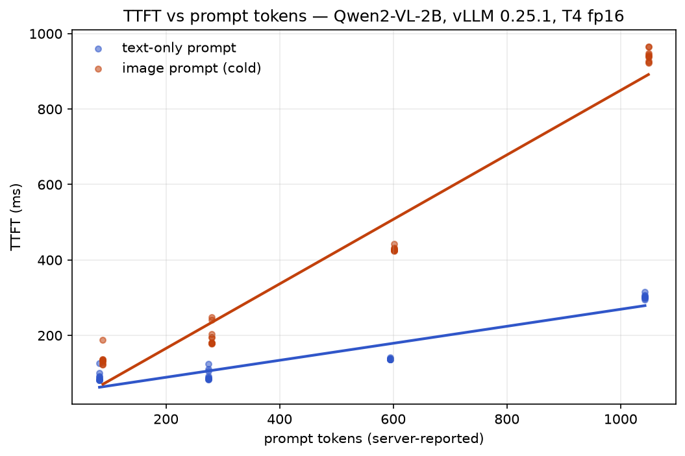
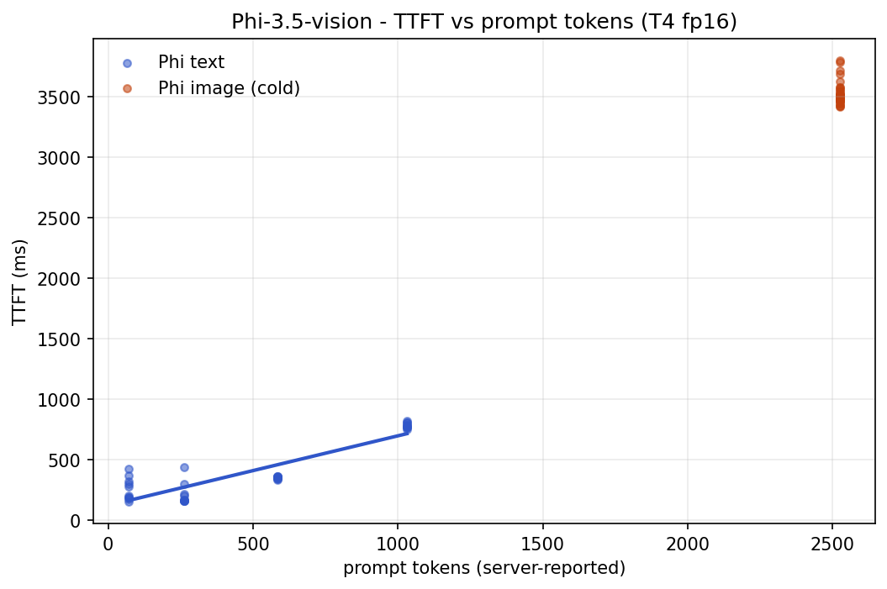
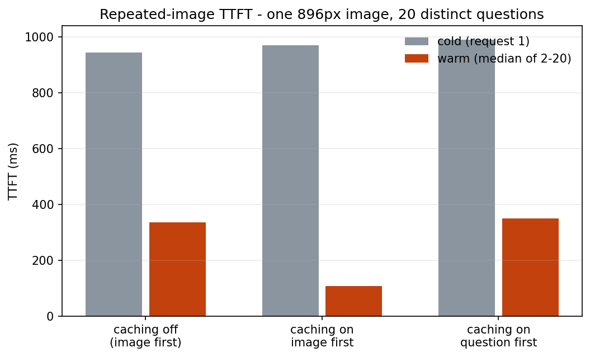

# t4-serving-bench

What does an image token cost? A serving-cost benchmark for vision-language
models, run entirely on a free Colab T4 with vLLM.

Two models — Qwen2-VL-2B-Instruct (dynamic-resolution ViT encoder) and
Phi-3.5-vision-instruct (fixed-crop CLIP encoder) — measured with the same
harness: calibrated workloads whose token counts are known in advance, a
streaming client that timestamps the first generated token (TTFT), and
token counts taken from the server's own `usage` metering.

## Findings

**1. An image token costs ~3.8× a text token in TTFT (Qwen2-VL).**
Text prompts and images at matched token counts (64–1024), ~10 cold
requests per point:

| | fitted TTFT | per 100 tokens |
|---|---|---|
| text | 44 ms + 0.225 ms/token | 22.5 ms |
| image | ~0.855 ms/token | 85.5 ms |



**2. The vision encoder is not a fixed overhead — its cost scales with
image area.** The image−text gap at matched token counts grows from 49 ms
(224px) to 638 ms (896px). More tiles mean more encoder attention, so the
encoder cost rides along with token count instead of being a flat fee.

**3. Encoder cost behavior is architectural.** The same protocol on
Phi-3.5-vision inverts the result: its HD-crop transform normalizes every
image to the same layout, so every size from 224px to 896px bills exactly
2525 tokens and takes a flat ~3.5 s (constant ~1.9 s encoder gap). Text
slopes track parameter count (57.5 vs 22.5 ms/100 tokens ≈ the 4.2B/2B
ratio); image latency does not — a 448px query is ~187 ms on Qwen2-VL vs
~3.5 s on Phi (~19×). Architecture, not model size, dominates image
serving cost. (Caveat: Phi's fee depends on `num_crops`, 16 here.)



**4. Prefix caching gives 8.9× on repeated images — if the prompt is
ordered right.** One 896px image, 20 distinct questions, three configs:

| config | cold | warm (median) |
|---|---|---|
| caching off | 943 ms | 335 ms |
| caching on, image before question | 969 ms | **109 ms** |
| caching on, question before image | 989 ms | 351 ms |

Question-first equals caching-off: the KV cache reuses only an identical
*prefix* (attention is causal), so the repeated content must come first.
And caching-off repeats still drop to 335 ms because vLLM's multimodal
preprocessor/encoder cache is a separate layer: it skips vision encoding
while prefill is re-paid (335 ms ≈ the text-only prefill cost at the same
token count). A repeated image lands in one of three cost tiers:
943 / 335 / 109 ms.



## How it works

```
bench/
  workloads.py   calibrated inputs: noise images on the 28px token grid,
                 text prompts trimmed to exact token counts, payloads
  client.py      streaming SSE client; TTFT at first content delta,
                 token counts from the final usage chunk
  server.py      vLLM launch configs (T4 flags, caching on/off, Phi)
  runner.py      sweeps; one JSON line per request, warmup excluded
  analyze.py     line fits, medians, first-occurrence dedup
tests/           24 CPU-only tests (no GPU needed to verify the harness)
notebooks/       self-contained Colab runners for each experiment
results/         raw JSONL per request, run metadata, figures
```

Qwen2-VL token accounting: after resizing to multiples of 28,
`image_tokens = (H/28) · (W/28)` (+2 vision delimiters) — verified against
the server's metering (448px image + question = 281 = 258 + 23 template).

## Reproducing

Each notebook in `notebooks/` runs top-to-bottom on a free Colab T4:

1. `exp0_gate.ipynb` — fp16 correctness gate (Qwen2-VL is bf16-trained;
   the T4 has no bf16 — verify coherent output before benchmarking)
2. `exp_tv_curves.ipynb` — text + image TTFT sweeps
3. `exp_c_caching.ipynb` — repeated-image caching, three configurations
4. `exp_m_phi.ipynb` — the same sweeps on Phi-3.5-vision

Note: install uses the **cu129 wheel** from vLLM's GitHub releases — the
default PyPI wheel for vllm 0.25.1 is built against CUDA 13 and fails on
Colab's CUDA-12 driver (`ImportError: libcudart.so.13`).

Local development needs no GPU: `pip install -e ".[dev]" && pytest`.

## Environment

vLLM 0.25.1+cu129 (V1 engine), fp16, Tesla T4 (SM 7.5). FlashAttention 2
is unsupported on Turing; the vision encoder runs TORCH_SDPA and the LLM
TRITON_ATTN. Prefix caching is on by default — which is why every cold
measurement uses a unique input. First requests after server start are
~45× slower than steady state (Triton kernel compilation); warmup
requests are excluded from all data.

## Limitations

Latency only — no concurrency, batching, or throughput measurements; one
GPU class; 2B–4B models; single-day runs on free-tier hardware (medians
over ~10 samples per point); Phi measured at `num_crops=16` only. Natural
next steps: concurrent-load sweeps and `num_crops` sensitivity.
